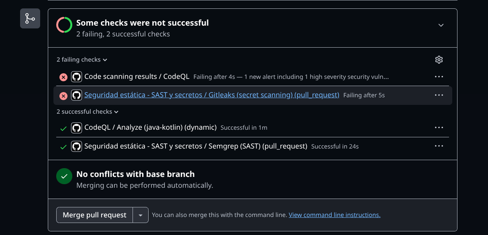
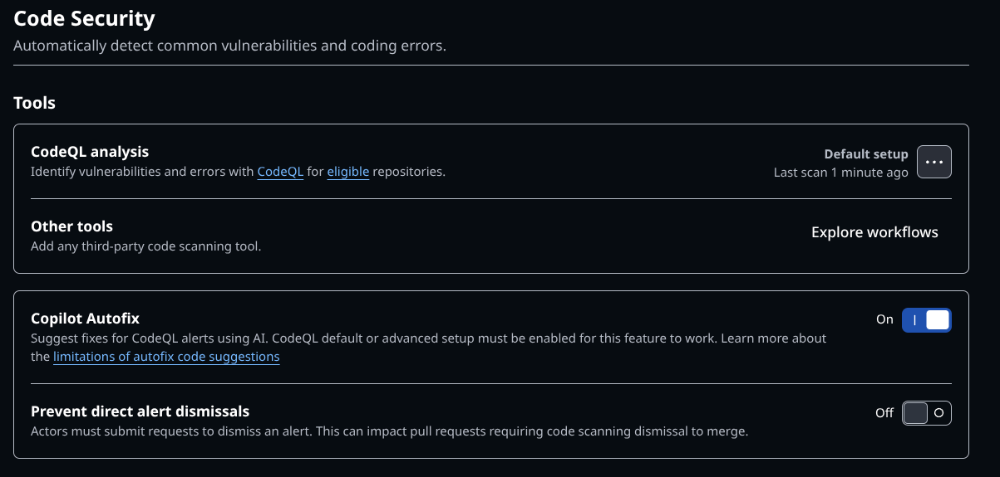
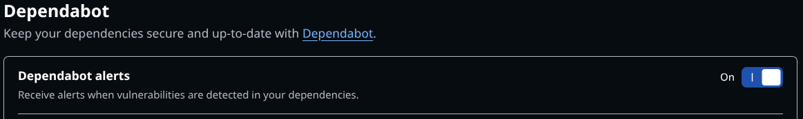
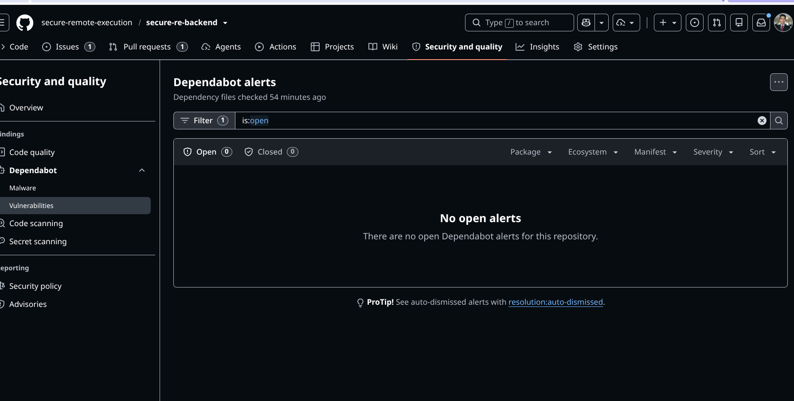
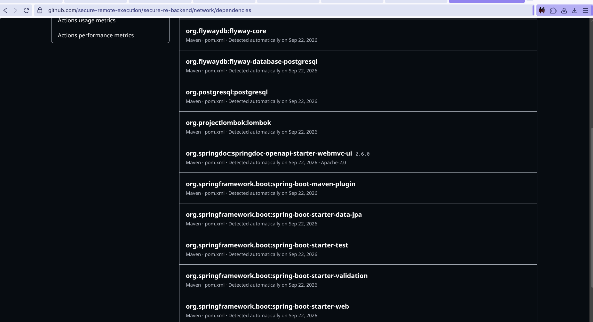

# Seguridad del proyecto — evidencia del laboratorio

## 1. Alcance autorizado
- Repositorios:
  - Backend: https://github.com/secure-remote-execution/secure-re-backend
  - Frontend: https://github.com/secure-remote-execution/secure-frontend
- Rama evaluada y commit:
  - Backend: `security/lab-fdsi` @ `eac91a787d56bab110187dc364a4c323da8a7784`
  - Frontend: `security/lab-fdsi` @ `40c0d53e4ecef8fb1755174eb6400f5fb6e93796`
- URL de staging propio: entorno de laboratorio local, Nginx (HTTPS self-signed)
  frente a backend en `localhost:8081`. IP de acceso en LAN variable (no es
  staging público ni productivo).
- Responsable / autorización: jdeltax \<vegavillamiljuanpablo@gmail.com\>,
  Tomas Olaya \<tomasdi.dev@gmail.com\> — 2026-10-21
- Fuera de alcance: producción, sistemas de terceros, datos reales y pruebas
  destructivas.

### Tecnología
- Backend: Java 21, Spring Boot 3.3, Spring Security + JWT (jjwt), Spring Data
  JPA, PostgreSQL 16, Flyway, springdoc-openapi.
- Frontend: React 18, TypeScript, Vite, react-router-dom.

### Activos identificados
- API REST del backend (inventario de dispositivos + simulador de scripts).
- Base de datos PostgreSQL (`secure_product_challenge`): tablas `devices`,
  `script_simulations`, `users` (credenciales con hash BCrypt).
- Secreto de firma JWT (`JWT_SECRET`) — activo crítico: quien lo posea puede
  forjar tokens válidos de cualquier rol.
- SPA frontend (sesión JWT en `localStorage` del navegador).
- Certificado TLS self-signed de Nginx + configuración de reverse proxy.
- Credenciales semilla `admin`/`viewer` usadas para pruebas del laboratorio.

### Flujo de autenticación
- `POST /api/auth/login` (público) recibe `{username, password}`, valida
  contra la tabla `users` (passwords en BCrypt) vía
  `DaoAuthenticationProvider`.
- Si es válido, emite un JWT firmado HS256 (claim `role`), expira en 480 min
  (8h) por defecto — configurable con `JWT_EXPIRATION_MINUTES`.
- El cliente guarda el token en `localStorage` y lo envía como
  `Authorization: Bearer <token>` en cada request.
- `JwtAuthenticationFilter` valida el token en cada request y puebla el
  `SecurityContext` (stateless, sin sesión de servidor).
- Autorización por rol (`@PreAuthorize`): `VIEWER` = solo lectura; `ADMIN` =
  lectura + `POST /api/scripts/simulate`.
- Toda operación queda trazada con el usuario autenticado (`performed_by` en
  `script_simulations`, `user=` en el log de acceso) — ninguna acción queda
  anónima.

### APIs expuestas (backend, puerto 8081, bajo `/api`)
| Método | Ruta | Auth | Descripción |
|---|---|---|---|
| POST | `/api/auth/login` | pública | Login, emite JWT |
| GET | `/api/devices` | VIEWER\|ADMIN | Lista inventario |
| GET | `/api/devices/{id}` | VIEWER\|ADMIN | Detalle de dispositivo |
| POST | `/api/scripts/simulate` | ADMIN | Simula script (trazado por usuario) |
| GET | `/api/scripts/simulate/history` | VIEWER\|ADMIN | Historial de simulaciones |
| GET | `/v3/api-docs`, `/swagger-ui.html` | pública | Documentación OpenAPI |

### Riesgo principal identificado
**Gestión de secretos/credenciales en el repositorio.** El `JWT_SECRET` por
defecto y las contraseñas de los usuarios semilla `admin`/`viewer` (valores
no reproducidos aquí) están documentados en texto plano en
`application.yml`, el README, `requests.http` y la migración Flyway. Quien tenga acceso de
lectura al repo conoce credenciales válidas y, si el despliegue real no
sobreescribe `JWT_SECRET`, puede forjar tokens JWT válidos de rol `ADMIN` sin
necesidad de autenticarse legítimamente. Ver hallazgo F-01 en la sección 3.

## 2. Línea base y herramientas
| Herramienta | Tipo | Fecha | Resultado | Enlace a evidencia |
|---|---|---|---|---|
| Semgrep (`p/owasp-top-ten`, `p/secrets`) | SAST | 2026-10-21 | **Antes**: 7 hallazgos: 5 WARNING (tags mutables en Actions) + 2 ERROR (hash BCrypt en migración SQL); 0 en código Java de la app. Check del PR: **Successful** | Artefacto `resultado-semgrep`;  |
| Semgrep — reescaneo local (mismas reglas) | SAST | 2026-11-02 | **Después de corregir F-04 y F-01**: backend 2 hallazgos (los 2 hashes de V2, ahora de contraseñas retiradas); 0 tags mutables. Frontend: 0 hallazgos | `evidence/semgrep-despues.json` |
| Gitleaks Action | Secretos | 2026-10-21 | Check del PR: **Failing** (after 5s) — limitación de licencia en repos de organización (ver F-06) |  |
| Gitleaks CLI (alternativa del kit) | Secretos | 2026-11-02 | Historial completo, `--redact`: backend 8 commits, frontend 7 commits — **sin fugas** | `evidence/gitleaks-cli-report.json` |
| CodeQL Default setup | SAST | 2026-10-21 | **Confirmado habilitado** (Default setup, último scan hace 1 min). Check del PR: **Failing** — "1 new alert including 1 high severity security vuln..." — triage hecho: falso positivo justificado (F-05) | ,  |
| Dependabot alerts | SCA | 2026-10-21 | Habilitado, 0 alertas abiertas en GitHub al momento de revisar (backend y frontend) | ,  |
| GitHub secret scanning (nativo) | Secretos | No confirmado | Pendiente de habilitar/verificar en `Settings → Advanced Security` | — |
| `npm audit` (frontend, manual) | SCA | 2026-10-21 | 2 altas (vite, source-map-js) — corregidas | ver hallazgo F-02 |
| Dependency graph (GitHub) | SCA | 2026-10-21 | Revisado manualmente para elegir F-03 (`org.postgresql:postgresql`) |  |
| OWASP ZAP Baseline | DAST pasivo | 2026-11-02 | Ejecutado **localmente** contra `https://localhost` (staging propio, no es alcanzable desde runners de GitHub — alternativa documentada según permite el enunciado). **Antes**: 0 FAIL, 7 WARN, 61 PASS sobre 5 URLs. **Después del fix F-07**: 0 FAIL, **6 WARN**, **62 PASS** (regla 10035 pasó de WARN a PASS). El workflow del kit `dast-staging.yml` quedó en el repo, pero no se ejecutó (requiere `STAGING_URL` alcanzable desde GitHub) | `evidence/zap-baseline-report.html` (antes), `evidence/zap-baseline-report-after.html` (después) |

> **Nota**: dos checks del PR quedaron en rojo (Gitleaks y CodeQL) pero **no bloquean el merge**. Gitleaks: limitación de licencia (F-06), ya con `GITLEAKS_LICENSE` en el workflow. CodeQL: falso positivo justificado (F-05); se pone en verde al descartar la alerta en GitHub.

## 3. Hallazgos y gestión
| ID | Categoría | Descripción sin secretos | Riesgo | Archivo/ruta | Cambio propuesto | Estado |
|---|---|---|---|---|---|---|
| F-01 | Gestión de secretos | Secreto de firma JWT y credenciales semilla documentados en texto plano en el repo. **Confirmado por herramienta**: Semgrep (`generic.secrets.security.detected-bcrypt-hash`) detectó los 2 hashes BCrypt en `V2__users_and_audit.sql` (severidad ERROR) | Alto | `application.yml`, `db/migration/V2__users_and_audit.sql`, `README.md`, `requests.http` | **Aplicado**: (1) `JWT_SECRET` sin valor por defecto — la app no arranca si falta (verificado). (2) Contraseñas de `admin`/`viewer` por `LAB_ADMIN_PASSWORD`/`LAB_VIEWER_PASSWORD`; `SeedUserPasswordInitializer` las re-hashea al arrancar y reemplaza los hashes de V2 (la contraseña versionada pasó de login 200 a 401). (3) Contraseñas en claro eliminadas de README y `requests.http`. (4) Test unitario `SeedUserPasswordInitializerTest` (3 casos). V2 no se edita: cambiar una migración aplicada rompe el checksum de Flyway | **Mitigado**. Riesgo residual: los 2 hashes y el comentario de V2 siguen en el repo y en el historial, pero ya no son credenciales válidas; Semgrep los seguirá reportando |
| F-05 | SAST — CodeQL | CodeQL (Default setup) marcó como alta severidad que `SecurityConfig` desactiva la protección CSRF de Spring (`.csrf(csrf -> csrf.disable())`, CWE-352). Copilot Autofix sugiere activarla (`.csrf(csrf -> {})`). **Triage**: CSRF solo es explotable si el navegador envía credenciales por su cuenta (cookies de sesión o auth básica). Validado: el login no emite ninguna cookie (`Set-Cookie` ausente), las sesiones son `STATELESS`, una petición con cookie y auth básica desde otro origen recibe `401`, y la única forma de autenticarse es el header `Authorization: Bearer` que pone el JS del frontend desde `localStorage` (un sitio atacante no puede leerlo ni hacer que el navegador lo envíe). Además, aplicando la sugerencia de Copilot el login legítimo pasa de `200` a `403`: rompe la app sin ganar seguridad | Falso positivo en este contexto (la regla es correcta para apps con sesión por cookie) | `security/SecurityConfig.java` | No aplicar el autofix. Se agregó un comentario en el código con la justificación. Descartar la alerta en GitHub (`Security → Code scanning → alerta → Dismiss → False positive`) con esta justificación. Si algún día se migra el JWT a una cookie, CSRF debe volver a activarse | **Cerrado — falso positivo justificado** (pendiente el *dismiss* en GitHub) |
| F-06 | CI/CD — Gitleaks | El check "Gitleaks (secret scanning)" del PR falla a los 5 s, antes de escanear. Gitleaks CLI sobre el historial completo de ambos repos no encontró fugas, así que la falla es consistente con que `gitleaks-action` exige `GITLEAKS_LICENSE` en repos de organización (lo advierten el kit y el propio workflow) | Informativo (limitación de herramienta, no vulnerabilidad) | `.github/workflows/seguridad-estatica.yml` | Alternativa aplicada: Gitleaks CLI local. Opciones a futuro: GitHub secret scanning nativo o licencia académica de Gitleaks | Cerrado — limitación técnica justificada |
| F-07 | DAST — header de seguridad faltante | ZAP (regla 10035) detectó `Strict-Transport-Security` ausente en las páginas estáticas (Nginx). Investigando la causa en el backend: Spring Security trae `HstsHeaderWriter` por defecto pero solo se activa si `request.isSecure()=true`; como Nginx habla con el backend por HTTP plano, sin confiar en `X-Forwarded-Proto` el backend tampoco mandaba el header. Validado con `curl` manual (ver `docs/REPORTE_HALLAZGOS.md`) | Media (protección defense-in-depth contra downgrade HTTP, no explotado activamente aquí) | `application.yml` (backend); `nginx.txt` / `/etc/nginx/nginx.conf` (estático) | **Backend corregido**: `server.forward-headers-strategy: framework` en `application.yml` — verificado con curl antes/después (header ahora presente). **Nginx**: header agregado a `nginx.txt` de referencia y aplicado en el servidor real con `sudo sed`/`nginx -t`/`systemctl reload` | **Corregido y verificado en ambos lados** (backend + Nginx), con reescaneo ZAP confirmando el cambio (regla 10035 pasó de WARN a PASS) |
| F-04 | Supply chain — CI/CD | 5 pasos de `.github/workflows/seguridad-estatica.yml` (`actions/checkout@v4` ×2, `actions/setup-python@v5`, `actions/upload-artifact@v4`, `gitleaks/gitleaks-action@v3`) referencian tags mutables en vez de un commit SHA fijo. Detectado por Semgrep (`yaml.github-actions.security.github-actions-mutable-action-tag`, WARNING ×5) | Medio (requiere que el maintainer de la Action sea comprometido; mismo vector que el incidente real de `tj-actions/changed-files`, marzo 2025) | `.github/workflows/seguridad-estatica.yml` (líneas 14, 15, 24, 33, 37) | **Aplicado** en ambos repos (`seguridad-estatica.yml` y también `dast-staging.yml`): cada `uses:` fijado a su commit SHA, verificado vía API de GitHub: `actions/checkout@11d5960a326750d5838078e36cf38b85af677262` (v4), `actions/setup-python@a26af69be951a213d495a4c3e4e4022e16d87065` (v5), `actions/upload-artifact@ea165f8d65b6e75b540449e92b4886f43607fa02` (v4), `gitleaks/gitleaks-action@e0c47f4f8be36e29cdc102c57e68cb5cbf0e8d1e` (v3) | **Corregido y verificado**: reescaneo Semgrep sin hallazgos de tags mutables (5 → 0) |
| F-03 | SCA — dependencia vulnerable | `org.postgresql:postgresql@42.7.4` (driver JDBC, resuelto transitivamente vía el BOM de `spring-boot-starter-parent:3.3.4`, sin versión explícita en `pom.xml`). Afectado por 3 advisories reales del GitHub Advisory Database: GHSA-hq9p-pm7w-8p54/CVE-2025-49146 (bypass de `channelBinding=require`, rango `>=42.7.4,<42.7.7`), GHSA-98qh-xjc8-98pq/CVE-2026-42198 (DoS por iteraciones PBKDF2 sin límite en SCRAM, rango `>=42.2.0,<42.7.11`) y GHSA-j92g-9f8w-j867/CVE-2026-54291 (downgrade silencioso de channel-binding, rango `>=42.7.4,<42.7.12`). Alcance real validado: hoy no usamos `channelBinding=require` ni TLS en la URL JDBC (`application.yml`), así que las 2 de channel-binding no aplican tal como está configurado hoy; la de DoS en SCRAM sí aplica en cualquier escenario (requiere un servidor Postgres malicioso/comprometido para explotarla, no un atacante de red) | Alto (DoS aplica siempre; downgrade de TLS solo si se activa channelBinding=require) | `secure-re-backend/pom.xml` | Override explícito de `postgresql.version` a `42.7.14` (última disponible en Maven Central, misma rama 42.7.x, sin cambios de API) vía `<properties>`. Verificado con `mvn dependency:tree` (resuelve 42.7.14), `mvn package` (compila y empaqueta OK) y en runtime (2026-11-02: backend arriba contra PostgreSQL real, login OK). Commit `8041375` | Corregido y verificado |
| F-02 | SCA — dependencia vulnerable | `vite@6.4.3` (directa) con 5 advisories del módulo `launch-editor` (CSRF/RCE contra el dev server, GHSA-r825-w8mm-5pxw entre otros) y su transitiva `source-map-js@1.2.1` (DoS por source-map malicioso, GHSA-68fv-2mgg-jv7q). Alcance real validado: ambos son herramientas de *build/dev-time* (Vite dev server y PostCSS en `npm run build`); no se incluyen en el bundle servido a usuarios finales (`dist/`), por lo que no afectan runtime en producción — sí afectan a cualquier dev que corra `npm run dev` y visite un sitio malicioso mientras el dev server está activo | Medio (dev-time), no aplica a prod | `secure-frontend/package.json`, `package-lock.json` | Aplicado `npm audit fix` (bump de parche dentro del rango ya declarado `^6.2.0`, sin breaking changes): `vite` 6.4.3→6.4.5, `source-map-js` 1.2.1→1.2.2. Verificado `npm run build` sin cambios en el bundle de salida | Cerrado |

### Explicación de 2 resultados de Semgrep y distinción de falsas alarmas
- **F-04 (tags mutables de Actions, WARNING ×5)**: hallazgo 100% accionable tal cual lo reporta la regla, sin matices — los 5 `uses:` efectivamente apuntan a un tag (`v4`/`v5`/`v3`), no a un SHA. No es falsa alarma.
- **F-01 confirmado (hash BCrypt, ERROR ×2)**: no es una falsa alarma — el patrón existe donde dice que existe — pero la propia regla marca `confidence: LOW`, y es importante matizar por qué: Semgrep solo puede ver el *hash* (que es unidireccional, no explotable por sí solo salvo crackeo offline de una password débil). La regla no tiene forma de saber que, en este repo, las *passwords en texto plano* que generaron esos hashes también están documentadas aparte (comentario del mismo SQL, README, `requests.http`) — ese es el riesgo real y es mayor de lo que esta regla puntual puede detectar. Por eso se mantiene como severidad Alta en F-01, no por el hash en sí.
- Ningún resultado del scan fue descartado como falso positivo en este repo: los 7 hallazgos (5+2) eran verdaderos positivos.
- **Después de corregir**: los 5 de F-04 desaparecen del reescaneo. Los 2 de F-01 siguen apareciendo porque V2 no se puede editar, pero ahora son hashes de contraseñas retiradas: es un riesgo residual documentado, no un falso positivo.

## 4. Validación antes y después
Caso principal: F-07 (HSTS).
- Evidencia inicial (captura o artefacto): `evidence/zap-baseline-report.html` — regla 10035 en `WARN-NEW`; `curl` al backend sin header `Strict-Transport-Security`.
- Pull request con corrección: backend [#6](https://github.com/secure-remote-execution/secure-re-backend/pull/6), commit `a49b93f` (`server.forward-headers-strategy: framework`). Header en Nginx aplicado en el servidor; la config de Nginx no está versionada en el repo.
- Evidencia de reescaneo: `evidence/zap-baseline-report-after.html` — regla 10035 en `PASS` (7→6 WARN, 61→62 PASS); `curl` al backend y al sitio estático muestran el header.
- Riesgo residual y decisión: quedan 6 WARN de ZAP de menor prioridad (CSP sin directivas explícitas, Permissions-Policy, COEP, caché), aceptados por ahora. Observación: en las respuestas de `/api` ahora llegan dos headers HSTS (uno del backend y otro de Nginx, que agrega `add_header` también a lo proxeado). El navegador procesa solo el primero, así que no es un riesgo, pero se puede limpiar con `proxy_hide_header Strict-Transport-Security;` en el `location` de la API. F-05 triado como falso positivo (ver sección 3).

Otros corregidos con antes/después:
- F-02: `npm audit` 2 altas → 0, commit `a62ff50`, PR [#2](https://github.com/secure-remote-execution/secure-frontend/pull/2).
- F-03: `42.7.4` → `42.7.14`, commit `8041375`.
- F-04: Semgrep, tags mutables 5 → 0.
- F-01: la contraseña versionada en V2 pasó de login 200 a 401; arranque sin `JWT_SECRET` falla; test unitario con 3 casos en verde.

## 5. Pentest autorizado
- Hipótesis: "el backend no envía `Strict-Transport-Security` aunque siempre está detrás de Nginx con HTTPS".
- Entorno de pruebas aislado: staging local (Nginx HTTPS self-signed + backend + PostgreSQL en Docker), datos ficticios.
- Solicitudes inocuas y respuestas observadas (sin datos personales): un `POST /api/auth/login` con la cuenta de laboratorio (`$LAB_USER`/`$LAB_PASS`), leyendo solo los headers de la respuesta. Antes: sin `Strict-Transport-Security`. Después: `Strict-Transport-Security: max-age=31536000 ; includeSubDomains`.
- Resultado: **validado** (reproducible, causa raíz identificada: Spring no confiaba en `X-Forwarded-Proto`).
- Recomendación y prueba de regresión: mantener `forward-headers-strategy` y el header en Nginx; prueba de regresión = los `curl` de `docs/REPORTE_HALLAZGOS.md` más el reescaneo ZAP. Mejora futura: un test de integración que verifique los headers de seguridad.
