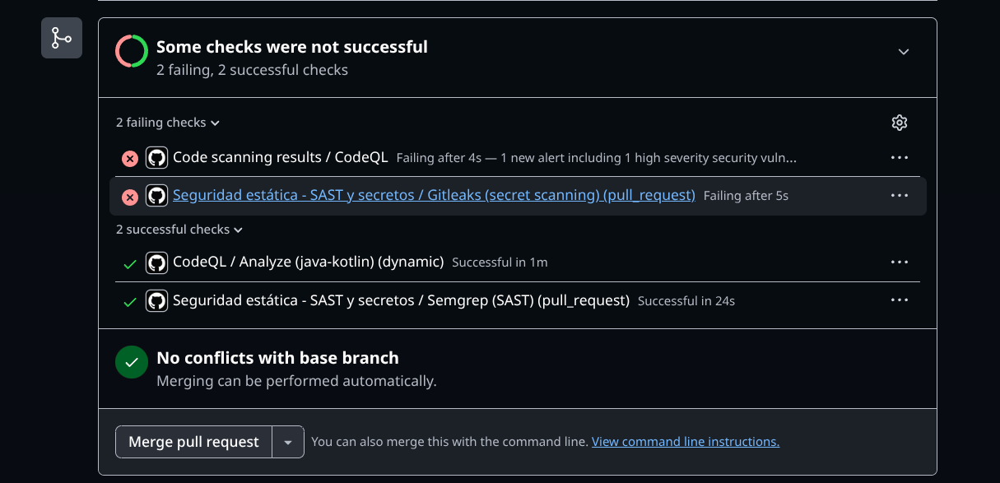
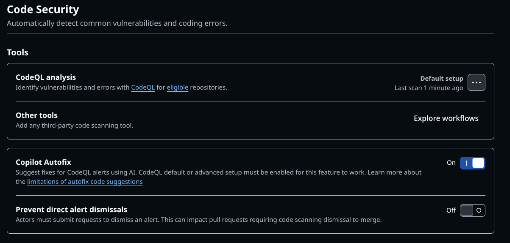
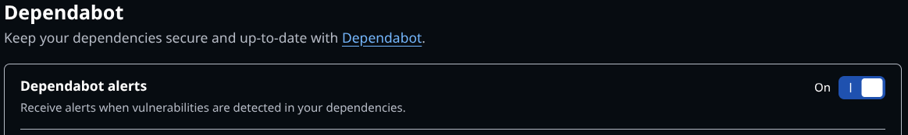
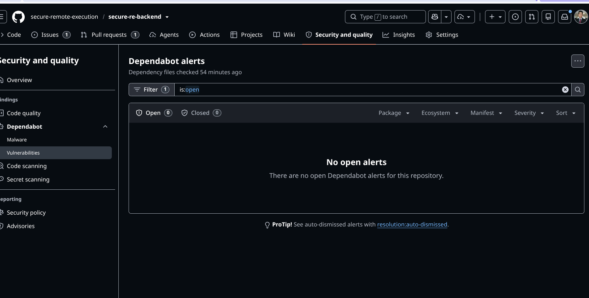
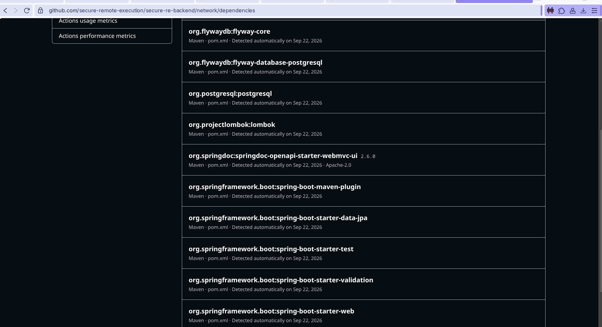

# Seguridad del proyecto — evidencia del laboratorio

## 1. Alcance autorizado
- Repositorios:
  - Backend: https://github.com/secure-remote-execution/secure-re-backend
  - Frontend: https://github.com/secure-remote-execution/secure-frontend
- Rama evaluada y commit:
  - Backend: `security/lab-fdsi` @ `eac91a787d56bab110187dc364a4c323da8a7784`
  - Frontend: `security/lab-fdsi` @ `40c0d53e4ecef8fb1755174eb6400f5fb6e93796`
- URL de staging propio: entorno de laboratorio local, Nginx (HTTPS self-signed)
  frente a backend en `localhost:8081`. IP de acceso en LAN variable (no es
  staging público ni productivo).
- Responsable / autorización: jdeltax \<vegavillamiljuanpablo@gmail.com\>,
  Tomas Olaya \<tomasdi.dev@gmail.com\> — 2026-10-21
- Fuera de alcance: producción, sistemas de terceros, datos reales y pruebas
  destructivas.

### Tecnología
- Backend: Java 21, Spring Boot 3.3, Spring Security + JWT (jjwt), Spring Data
  JPA, PostgreSQL 16, Flyway, springdoc-openapi.
- Frontend: React 18, TypeScript, Vite, react-router-dom.

### Activos identificados
- API REST del backend (inventario de dispositivos + simulador de scripts).
- Base de datos PostgreSQL (`secure_product_challenge`): tablas `devices`,
  `script_simulations`, `users` (credenciales con hash BCrypt).
- Secreto de firma JWT (`JWT_SECRET`) — activo crítico: quien lo posea puede
  forjar tokens válidos de cualquier rol.
- SPA frontend (sesión JWT en `localStorage` del navegador).
- Certificado TLS self-signed de Nginx + configuración de reverse proxy.
- Credenciales semilla `admin`/`viewer` usadas para pruebas del laboratorio.

### Flujo de autenticación
- `POST /api/auth/login` (público) recibe `{username, password}`, valida
  contra la tabla `users` (passwords en BCrypt) vía
  `DaoAuthenticationProvider`.
- Si es válido, emite un JWT firmado HS256 (claim `role`), expira en 480 min
  (8h) por defecto — configurable con `JWT_EXPIRATION_MINUTES`.
- El cliente guarda el token en `localStorage` y lo envía como
  `Authorization: Bearer <token>` en cada request.
- `JwtAuthenticationFilter` valida el token en cada request y puebla el
  `SecurityContext` (stateless, sin sesión de servidor).
- Autorización por rol (`@PreAuthorize`): `VIEWER` = solo lectura; `ADMIN` =
  lectura + `POST /api/scripts/simulate`.
- Toda operación queda trazada con el usuario autenticado (`performed_by` en
  `script_simulations`, `user=` en el log de acceso) — ninguna acción queda
  anónima.

### APIs expuestas (backend, puerto 8081, bajo `/api`)
| Método | Ruta | Auth | Descripción |
|---|---|---|---|
| POST | `/api/auth/login` | pública | Login, emite JWT |
| GET | `/api/devices` | VIEWER\|ADMIN | Lista inventario |
| GET | `/api/devices/{id}` | VIEWER\|ADMIN | Detalle de dispositivo |
| POST | `/api/scripts/simulate` | ADMIN | Simula script (trazado por usuario) |
| GET | `/api/scripts/simulate/history` | VIEWER\|ADMIN | Historial de simulaciones |
| GET | `/v3/api-docs`, `/swagger-ui.html` | pública | Documentación OpenAPI |

### Riesgo principal identificado
**Gestión de secretos/credenciales en el repositorio.** El `JWT_SECRET` por
defecto y las contraseñas de los usuarios semilla (`admin`/`Admin123!`,
`viewer`/`Viewer123!`) están documentados en texto plano en
`application.yml`, el README y la migración Flyway. Quien tenga acceso de
lectura al repo conoce credenciales válidas y, si el despliegue real no
sobreescribe `JWT_SECRET`, puede forjar tokens JWT válidos de rol `ADMIN` sin
necesidad de autenticarse legítimamente. Ver hallazgo F-01 en la sección 3.

## 2. Línea base y herramientas
| Herramienta | Tipo | Fecha | Resultado | Enlace a evidencia |
|---|---|---|---|---|
| Semgrep (`p/owasp-top-ten`, `p/secrets`) | SAST | 2026-10-21 | 7 hallazgos: 5 WARNING (tags mutables en Actions) + 2 ERROR (hash BCrypt en migración SQL); 0 en código Java de la app. Check del PR: **Successful** | Artefacto `resultado-semgrep`;  |
| Gitleaks | Secretos | 2026-10-21 | Check del PR: **Failing** (after 5s) — causa no confirmada aún, el propio workflow advierte que repos de organización pueden requerir `GITLEAKS_LICENSE` (ver nota abajo) |  |
| CodeQL Default setup | SAST | 2026-10-21 | **Confirmado habilitado** (Default setup, último scan hace 1 min). Check del PR: **Failing** — "1 new alert including 1 high severity security vuln..." (detalle del hallazgo aún no revisado, ver nota abajo) | ,  |
| Dependabot alerts | SCA | 2026-10-21 | Habilitado, 0 alertas abiertas en GitHub al momento de revisar (backend y frontend) | ,  |
| GitHub secret scanning (nativo) | Secretos | No confirmado | Pendiente de habilitar/verificar en `Settings → Advanced Security` | — |
| `npm audit` (frontend, manual) | SCA | 2026-10-21 | 2 altas (vite, source-map-js) — corregidas | ver hallazgo F-02 |
| Dependency graph (GitHub) | SCA | 2026-10-21 | Revisado manualmente para elegir F-03 (`org.postgresql:postgresql`) |  |
| OWASP ZAP Baseline | DAST pasivo | No configurado | — | — |

> **Nota**: dos checks del PR quedaron en rojo (Gitleaks y CodeQL) pero **no bloquean el merge** — GitHub mostró "No conflicts with base branch, merging can be performed automatically". Ambos quedan como hallazgos abiertos (F-05, F-06) hasta revisar el detalle de cada uno antes de mergear.

## 3. Hallazgos y gestión
| ID | Categoría | Descripción sin secretos | Riesgo | Archivo/ruta | Cambio propuesto | Estado |
|---|---|---|---|---|---|---|
| F-01 | Gestión de secretos | Secreto de firma JWT y credenciales semilla documentados en texto plano en el repo. **Confirmado por herramienta**: Semgrep (`generic.secrets.security.detected-bcrypt-hash`) detectó los 2 hashes BCrypt en `V2__users_and_audit.sql` (severidad ERROR) | Alto | `application.yml`, `db/migration/V2__users_and_audit.sql`, `README.md` | Exigir `JWT_SECRET` por variable de entorno sin default en builds no-dev (fail-fast si falta); rotar/eliminar credenciales semilla documentadas antes de cualquier despliegue real | Abierto |
| F-05 | SAST — CodeQL | El check "Code scanning results / CodeQL" del PR falla reportando "1 new alert including 1 high severity security vulnerability". **Detalle del hallazgo aún no revisado** (no se abrió la pestaña Code scanning alerts todavía) | Alto (severidad reportada por GitHub, sin confirmar aplicabilidad real todavía) | Por determinar — pendiente de abrir el detalle en `Security → Code scanning` | Abrir el hallazgo específico en GitHub, documentar archivo/línea y CWE, y recién ahí decidir si aplica (mismo criterio de validación que F-02/F-03, no asumir severidad a ciegas) | Abierto — pendiente de triage |
| F-06 | CI/CD — Gitleaks | El check "Gitleaks (secret scanning)" del PR falla ("Failing after 5s"). Causa no confirmada: puede ser un secreto real detectado, o el workflow puede requerir `GITLEAKS_LICENSE` por ser un repo de organización (advertencia ya presente como comentario en `seguridad-estatica.yml`) | Por determinar | `.github/workflows/seguridad-estatica.yml` | Revisar el log del job Gitleaks en Actions para diferenciar "secreto real encontrado" vs "falla por falta de licencia"; si es lo segundo, documentar el límite de la herramienta en este plan gratuito/org y no tratarlo como vulnerabilidad | Abierto — pendiente de triage |
| F-04 | Supply chain — CI/CD | 5 pasos de `.github/workflows/seguridad-estatica.yml` (`actions/checkout@v4` ×2, `actions/setup-python@v5`, `actions/upload-artifact@v4`, `gitleaks/gitleaks-action@v3`) referencian tags mutables en vez de un commit SHA fijo. Detectado por Semgrep (`yaml.github-actions.security.github-actions-mutable-action-tag`, WARNING ×5) | Medio (requiere que el maintainer de la Action sea comprometido; mismo vector que el incidente real de `tj-actions/changed-files`, marzo 2025) | `.github/workflows/seguridad-estatica.yml` (líneas 14, 15, 24, 33, 37) | Pinnear cada `uses:` a su commit SHA actual (verificados vía API de GitHub): `actions/checkout@11d5960a326750d5838078e36cf38b85af677262` (v4), `actions/setup-python@a26af69be951a213d495a4c3e4e4022e16d87065` (v5), `actions/upload-artifact@ea165f8d65b6e75b540449e92b4886f43607fa02` (v4), `gitleaks/gitleaks-action@e0c47f4f8be36e29cdc102c57e68cb5cbf0e8d1e` (v3) | Abierto |
| F-03 | SCA — dependencia vulnerable | `org.postgresql:postgresql@42.7.4` (driver JDBC, resuelto transitivamente vía el BOM de `spring-boot-starter-parent:3.3.4`, sin versión explícita en `pom.xml`). Afectado por 3 advisories reales del GitHub Advisory Database: GHSA-hq9p-pm7w-8p54/CVE-2025-49146 (bypass de `channelBinding=require`, rango `>=42.7.4,<42.7.7`), GHSA-98qh-xjc8-98pq/CVE-2026-42198 (DoS por iteraciones PBKDF2 sin límite en SCRAM, rango `>=42.2.0,<42.7.11`) y GHSA-j92g-9f8w-j867/CVE-2026-54291 (downgrade silencioso de channel-binding, rango `>=42.7.4,<42.7.12`). Alcance real validado: hoy no usamos `channelBinding=require` ni TLS en la URL JDBC (`application.yml`), así que las 2 de channel-binding no aplican tal como está configurado hoy; la de DoS en SCRAM sí aplica en cualquier escenario (requiere un servidor Postgres malicioso/comprometido para explotarla, no un atacante de red) | Alto (DoS aplica siempre; downgrade de TLS solo si se activa channelBinding=require) | `secure-re-backend/pom.xml` | Override explícito de `postgresql.version` a `42.7.14` (última disponible en Maven Central, misma rama 42.7.x, sin cambios de API) vía `<properties>`. Verificado con `mvn dependency:tree` (resuelve 42.7.14) y `mvn package` (compila y empaqueta OK). Pendiente probar contra Postgres real (requiere `docker compose up -d`, no disponible en este entorno) | Corregido (pendiente verificación runtime) |
| F-02 | SCA — dependencia vulnerable | `vite@6.4.3` (directa) con 5 advisories del módulo `launch-editor` (CSRF/RCE contra el dev server, GHSA-r825-w8mm-5pxw entre otros) y su transitiva `source-map-js@1.2.1` (DoS por source-map malicioso, GHSA-68fv-2mgg-jv7q). Alcance real validado: ambos son herramientas de *build/dev-time* (Vite dev server y PostCSS en `npm run build`); no se incluyen en el bundle servido a usuarios finales (`dist/`), por lo que no afectan runtime en producción — sí afectan a cualquier dev que corra `npm run dev` y visite un sitio malicioso mientras el dev server está activo | Medio (dev-time), no aplica a prod | `secure-frontend/package.json`, `package-lock.json` | Aplicado `npm audit fix` (bump de parche dentro del rango ya declarado `^6.2.0`, sin breaking changes): `vite` 6.4.3→6.4.5, `source-map-js` 1.2.1→1.2.2. Verificado `npm run build` sin cambios en el bundle de salida | Cerrado |

### Explicación de 2 resultados de Semgrep y distinción de falsas alarmas
- **F-04 (tags mutables de Actions, WARNING ×5)**: hallazgo 100% accionable tal cual lo reporta la regla, sin matices — los 5 `uses:` efectivamente apuntan a un tag (`v4`/`v5`/`v3`), no a un SHA. No es falsa alarma.
- **F-01 confirmado (hash BCrypt, ERROR ×2)**: no es una falsa alarma — el patrón existe donde dice que existe — pero la propia regla marca `confidence: LOW`, y es importante matizar por qué: Semgrep solo puede ver el *hash* (que es unidireccional, no explotable por sí solo salvo crackeo offline de una password débil). La regla no tiene forma de saber que, en este repo, las *passwords en texto plano* que generaron esos hashes también están documentadas aparte (comentario del mismo SQL, README, `requests.http`) — ese es el riesgo real y es mayor de lo que esta regla puntual puede detectar. Por eso se mantiene como severidad Alta en F-01, no por el hash en sí.
- Ningún resultado del scan fue descartado como falso positivo en este repo: los 7 hallazgos (5+2) son todos verdaderos positivos sobre el estado actual del código.

## 4. Validación antes y después
- Evidencia inicial (captura o artefacto): pendiente — workflow aún no ejecutado en CI.
- Pull request con corrección: pendiente.
- Evidencia de reescaneo: pendiente.
- Riesgo residual y decisión: pendiente.

## 5. Pentest autorizado
- Hipótesis: pendiente de definir.
- Entorno de pruebas aislado: laboratorio local (ver sección 1).
- Solicitudes inocuas y respuestas observadas (sin datos personales): pendiente.
- Resultado: pendiente
- Recomendación y prueba de regresión: pendiente.
